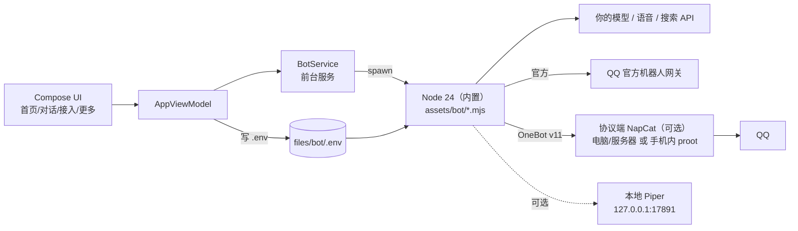

# ferrybot · 把 AI 聊天机器人装进 Android 手机

Kotlin + Jetpack Compose 原生界面，机器人逻辑跑在 App 内置的 **Node 24** 运行时里；可选在手机里用
proot 装一套 Ubuntu，用来跑**真实 QQ 协议端**和**本地语音模型**。不需要电脑、不需要服务器、不需要 root。


> 自用向开源工具，不是商业产品。接入真实 QQ 走第三方协议端，**属于非官方途径、有封号风险**；
> 本项目与腾讯、阿里等平台**无关联、未获授权或背书**。请先读 [隐私与合规](#隐私与合规) 再决定用不用。

| 项目 | 说明 |
|---|---|
| 当前版本 | `1.0.52`（versionCode 53），见 [CHANGELOG.md](CHANGELOG.md) |
| 安装包 | release 约 **23.9 MB** / debug 约 34.3 MB |
| 系统要求 | Android 8.0+（minSdk 26），**仅 arm64** |
| 包名 | `com.qqbot.app` |
| 技术栈 | Kotlin 2.3 / Compose BOM 2025.09 / AGP 9.3 / compileSdk 35 / targetSdk 28 |
| 为什么 targetSdk = 28 | Android 10+ 禁止从 App 私有目录执行二进制；只有 ≤28 才能在手机里跑解压出来的 node / proot（Termux 同理） |

## 它能做什么

**聊天与人格**

- 单聊、群 @ 自动回复；模型走任意 **OpenAI 兼容**接口，地址 / 模型 / Key 自己填
- 人设可编辑，内置「默认 / 甜妹 / 高冷 / 毒舌」四套预设；回复风格、消息条数、发语音概率、打字延迟可调
- **可导入聊天记录 / 语料**：在「对话 → 人设 → 说话方式」选一个 `.txt` / `.json` / `.jsonl`，它照着那些话的语气、用词和标点说（只学风格，不照抄内容，进提示词的部分有字数上限）
- 记忆分层：短记忆 + 长期画像，长度与开关可调，界面直接标注对花费的影响

**消息与素材**

- 文本、图片、语音、表情包、链接
- 表情包 / 图片可按概率附带；给素材打标签后模型会按语境挑
- 对方发来的链接自动抓正文再回；收藏的链接可按概率附带发送
- 联网搜索：模型判断需要时检索，服务商与 Key 自填（Tavily / Serper / Bing / Bocha）

**主动消息**

- 条数、间隔、时段、风格（关心 / 暧昧 / 吐槽 / 自定义模板）可调
- 目标可选「最近聊过的人」；带语音、带链接的概率可填百分数
- 支持「别主动找我」暂停

**语音**

- 合成：现成音色 / 云端声音复刻（上传录音生成音色）/ **手机本地 Piper**（免费离线）
- 识别：收到语音先解码，再送你自己配的语音识别服务
- 按 QQ 的 SILK 格式上传，能直接变成语音条

**技能（插件）与运维**

- JS 技能：`.mjs` / `.js` 单文件或 zip，跑在内置 Node 里
- 进程技能：`plugin.json` 声明命令，跑在手机里的 Linux 环境，支持 Python / shell / 任意 Linux 命令
- 导入后 1 分钟内自动生效，可启用 / 停用 / 删除
- 前台服务保活、开机自启（开关在「对话 → 消息」）；安装器支持断点续传、分片并发、镜像切换、失败续装、空间预检
- 内置命令（默认仅管理员可用）：`#状态` `#磁盘` `#日志` `#帮助` `/usage` `/reset` `/resetall`

## 架构一句话

界面是 Kotlin/Compose，业务全在子进程 `node bot.mjs` 里；两者只通过 `.env` + 日志 + `data/` 文件交互。
可选再起 proot 里的协议端 / 本地 TTS。没有本地 API 端口，App 也没有作者服务器。



更细的分层、源码地图、线程与端口约定见 [docs/ARCHITECTURE.md](docs/ARCHITECTURE.md)。

## 两种接入方式

| | QQ 官方机器人（默认） | 真实 QQ |
|---|---|---|
| 身份 | 平台上创建的机器人 | 你自己的 QQ 号 |
| 需要 | q.qq.com 申请 AppID / AppSecret | 一个协议端（NapCat / Lagrange） |
| 主动消息 | 受限：只能发给最近交互过的用户/群 | 基本不受限 |
| 加好友 / 进群 | 不能主动加 | 协议端上操作 |
| 合规 | 官方途径 | **非官方途径，可能违反腾讯协议，有封号风险** |
| 适合 | 想稳定、长期挂着 | 想要「像真人」的体验 |

App 对真实 QQ 只做 **OneBot v11 客户端**，不内置 QQ 协议实现。协议端可以：

1. 跑在电脑 / 服务器上（NapCat、Lagrange 等），App 里填 `ws://IP:3001` + token
2. 跑在手机里：用 App 的「运行环境」一键装 Ubuntu + NapCat（约 470 MB 下载 / 1.5–1.8 GB 占盘），扫码登录，不需要电脑

## 快速开始

### A. QQ 官方机器人

```
1. 打开 App，首页点「获取环境」等十几秒（解压内置 Node 运行时，约 90 MB）
2. q.qq.com 创建机器人 → 拿 AppID / AppSecret
   「开发设置」里事件订阅选 WebSocket，勾选单聊消息 + 群 @ 消息
3. 「接入」页填 AppID / AppSecret / 模型 API Key（地址留空用默认，可改）
4. 回首页点「启动机器人」
```

### B. 真实 QQ（手机内跑协议端）

```
1. 「接入 → 运行环境」→ 安装内容选「NapCat」→ 下载并安装（约 470 MB，建议剩 2.4 GB）
2. 装完点「启动协议端」→ 出二维码 → 用另一台手机扫码登录你的 QQ 小号
3. 「接入」页接入方式选「真实QQ」，地址和 token 会自动回填
4. 填模型 Key → 启动机器人
```

可选再装：「Python 3 支持」（给 Python 进程技能用）、「Piper 本地语音」（免费离线 TTS）。

### 启动后

- 通知栏那条常驻通知是保活用的，别关
- 保活三件套：电池 → 允许后台活动；手机管家 → 允许自启动；最近任务 → 锁定卡片
- 日志在「更多 → 运行日志」，出问题先看它；更多排错见 [docs/FAQ.md](docs/FAQ.md)

## 设置项在哪

| 想改 | 位置 |
|---|---|
| 接入方式 / AppID / 模型地址 / Key | 接入 → 接入方式、模型 |
| 安装协议端 / 看二维码 / 环境日志 | 接入 → 运行环境 |
| 人设、名字、预设、说话方式语料 | 对话 → 人设 |
| 主动消息风格 / 频率 / 对象 | 对话 → 主动消息 |
| 消息类型开关、条数概率、指令权限、开机自启 | 对话 → 消息 |
| 语音合成 / 识别 / 本地语音自检 | 对话 → 语音 |
| 记忆长度、长期记忆 | 对话 → 记忆 |
| 表情包 / 图片 / 链接库 / 技能 | 更多 → 素材、高级 |
| 命令说明、运行日志、关于 | 更多 |

所有开关都对应 `files/bot/.env` 里的一个键；界面改就够，一般不用手编（手改后重启机器人同样生效）。

## 需要准备什么

- **一台 arm64 安卓手机**（8.0+），能装未知来源 APK
- **模型 Key**：任意 OpenAI 兼容服务。轻度自用每月几元到几十元，看聊天量
- **（可选）语音 Key**：云端合成/识别/声音复刻要另配；不想花钱就用本地 Piper
- **（可选）搜索 API Key**：想让它联网查东西才需要
- **（可选）一个 QQ 小号**：真实 QQ 玩法建议用小号

具体花销以各平台实际计费为准，这里只是量级参考。

## 构建

需要 **JDK 21** + **Android SDK Platform 35**（编译目标仍是 Java 17 字节码，原因见 [构建说明.md](构建说明.md#一环境要求)）。

```bash
# macOS / Linux
./gradlew :app:assembleRelease --console=plain

# Windows
gradlew.bat :app:assembleRelease --console=plain
```

产物：`app/build/outputs/apk/release/app-release.apk`（R8 混淆 + 资源压缩，约 23.9 MB）。

- release 默认用 **debug 签名**，方便与 debug 包互相覆盖安装；正式分发请自己配签名（**别提交 keystore**）
- 完整环境、版本矩阵、AGP 9 的坑、报错对照表、签名与发布：[构建说明.md](构建说明.md)
- 改完代码怎么生效（`BOT_CODE_VERSION` / `RUNTIME_VERSION`）也在这份文档里

## 目录结构

```text
app/src/main/
├── java/com/qqbot/app/
│   ├── MainActivity.kt        导航骨架（首页 / 对话 / 接入 / 更多 + 二级页）
│   ├── BotService.kt          前台服务：spawn Node 跑机器人
│   ├── ProtoManager.kt        协议端进程单例（跨页面存活，服务重启能恢复）
│   ├── ProtoConfig.kt         写 NapCat 的 WebUI / OneBot 配置
│   ├── NapCatQr.kt            取 NapCat 登录二维码（WebUI + ZXing）
│   ├── EnvManager.kt          铺 Node 运行时（node.xz / icu 数据 / .so）
│   ├── EnvInstaller.kt        通用安装器（下载 / 校验 / 解压 / 步骤）
│   ├── LinuxEnv.kt            proot + rootfs：解压、执行、环境变量
│   ├── DebExtract.kt          .deb 解包（ar + xz/gzip + tar）
│   ├── LocalTts.kt            本地 Piper 的 HTTP 桥（127.0.0.1:17891）
│   ├── VoiceEnroll.kt         云端声音复刻（创建音色）
│   ├── Skills.kt              技能目录（JS 技能 / 进程技能）
│   ├── StyleCorpus.kt         说话方式语料：解析导入的聊天记录 / 句子
│   ├── ConfigStore.kt         配置读写（.env + 预设人设）
│   ├── ModelCatalog.kt        模型列表 / QQ 凭证校验
│   ├── LogText.kt             日志清洗（去 ANSI / 噪声行）
│   ├── BootReceiver.kt        开机自启
│   └── ui/                    Compose 界面（各 Tab、二级页、公共组件）
├── assets/
│   ├── bot/                   机器人代码（bot.mjs + lib/*.mjs + skills/）
│   ├── installers/            一键安装包定义：napcat / piper / python3
│   ├── demo-skill.mjs         JS 技能示例
│   ├── demo-process/          进程技能示例（plugin.json + main.sh）
│   └── runtime/               Node 运行时（压缩资产 + arm64 .so）
└── res/

docs/
├── ARCHITECTURE.md            分层 / 源码地图 / 接入链路 / 端口约定
├── FAQ.md                     常见问题与排错
├── PRIVACY.md                 数据处理与隐私
├── THIRD_PARTY.md             第三方组件与许可
├── research-napcat.md         手机内跑 NapCat 的调研
└── research-env.md            手机内 Linux 环境的资源与方案
```

## 隐私与合规

- 配置、人设、记忆、素材、技能全部存在 App 私有目录，**卸载即删**；没有作者账号、没有云端、没有遥测。
- 聊天内容会发给你**自己配置**的模型 / 语音 / 搜索服务，请遵守对应平台条款。
- 内置运行时与下载的协议端/模型均来自公开渠道，各自许可见 [docs/THIRD_PARTY.md](docs/THIRD_PARTY.md)。
- 细节与安全边界：[docs/PRIVACY.md](docs/PRIVACY.md)、[SECURITY.md](SECURITY.md)。

**合规红线（务必看）**

- 本项目是第三方工具，与腾讯、阿里等平台**无关联、未获授权或背书**。
- 真实 QQ 接入依赖第三方协议实现，**可能违反腾讯用户协议**，账号有被限制或封禁的风险。
- 只能用于**你自己合法持有**的账号、**你自己申请**的凭证。
- 禁止用于骚扰、诈骗、冒充他人、批量营销、传播违法信息。
- AI 生成内容的责任、语音复刻涉及的肖像/声音权利，由使用者自行承担。

## 已知限制

- **只支持 arm64**：内置 Node、proot、LinuxQQ 都是 arm64，模拟器/32 位机器不行
- **官方机器人不能给陌生人主动发消息**：只能发给最近交互过的用户/群，部分能力要在开放平台申请
- **手机内协议端不保证长期在线**：phantom process killer 与厂商省电策略都可能杀掉它
- **没有 Play 商店版本**：targetSdk 28 不满足上架要求，且第三方 QQ 客户端本身有合规风险
- **不支持**：个人微信自动化、exe 插件、Node 原生插件（`.node` / `.so`）、实时语音通话

## 文档导航

| 文档 | 内容 |
|---|---|
| [构建说明.md](构建说明.md) | 环境、构建、签名、版本戳、报错对照、提交前检查 |
| [docs/ARCHITECTURE.md](docs/ARCHITECTURE.md) | 分层架构、Kotlin/JS 源码地图、接入链路、端口与进程 |
| [docs/FAQ.md](docs/FAQ.md) | 安装、费用、封号、掉线、数据、构建等常见问题 |
| [docs/PRIVACY.md](docs/PRIVACY.md) | 数据存哪、什么会离开手机、权限、安全提示 |
| [docs/THIRD_PARTY.md](docs/THIRD_PARTY.md) | 随仓库分发与运行时下载的第三方组件及许可 |
| [CHANGELOG.md](CHANGELOG.md) | 版本变更记录 |
| [CONTRIBUTING.md](CONTRIBUTING.md) | 开发约定、提交前检查、PR 规则 |
| [SECURITY.md](SECURITY.md) | 安全问题报告渠道与安全边界 |

## 许可

本项目代码以 [MIT](LICENSE) 发布。**但注意**：仓库内的第三方运行时/二进制（Node、ICU、OpenSSL 等）
仍遵循各自许可；运行时下载的 NapCat、LinuxQQ、Ubuntu、Piper 等同样遵循各自许可，
详见 [docs/THIRD_PARTY.md](docs/THIRD_PARTY.md)。涉及协议逆向或平台条款的使用场景，请自行评估风险。